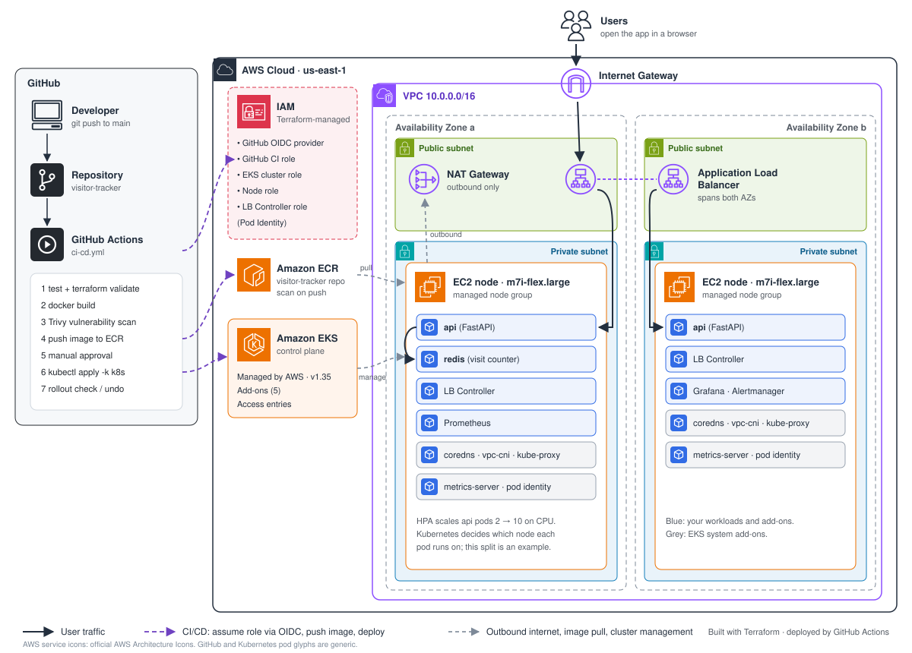
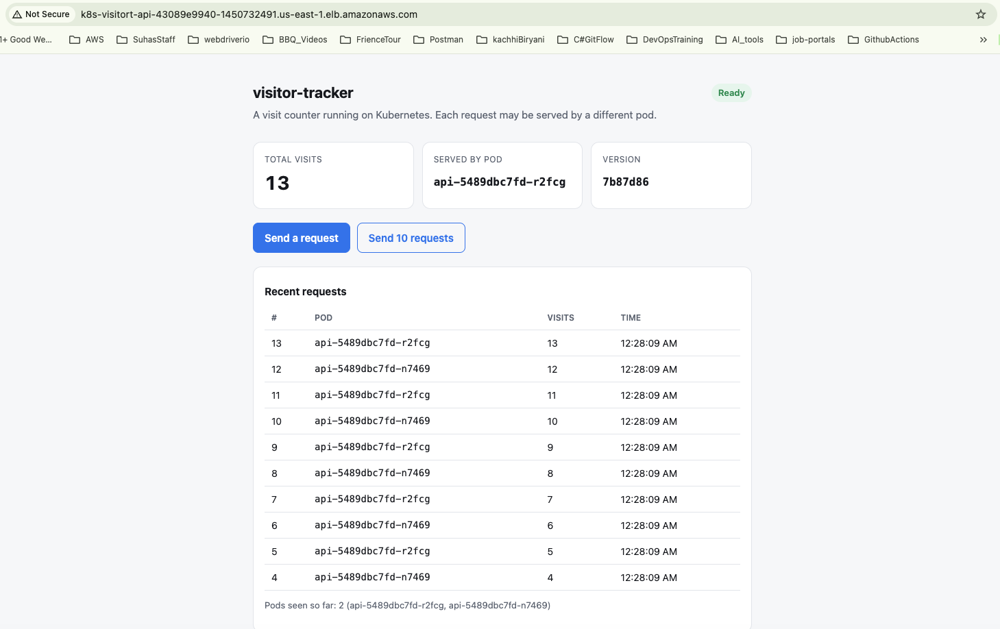
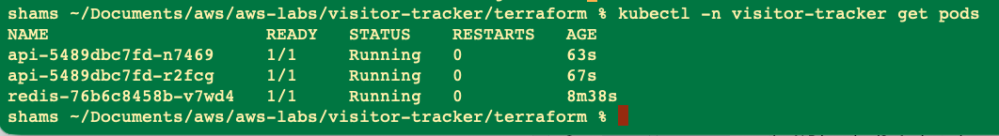
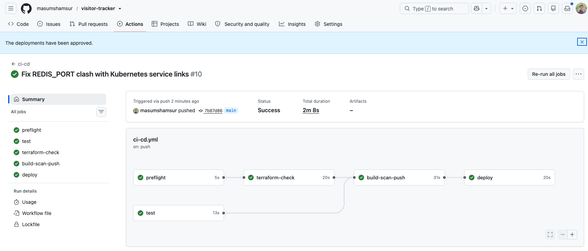
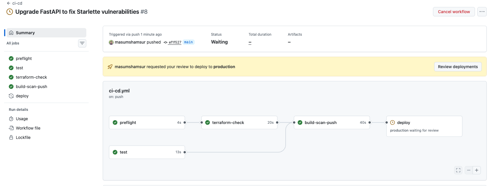
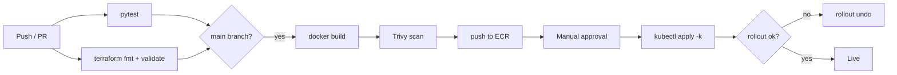

# visitor-tracker · 2-tier app on AWS EKS with Terraform and CI/CD

[](https://github.com/masumshamsur/visitor-tracker/actions/workflows/ci-cd.yml)


A FastAPI visit counter backed by Redis, running on **Amazon EKS** behind an **Application Load Balancer**. All infrastructure is built with **Terraform**. Every push goes through **GitHub Actions**: tests, Terraform checks, a Docker build, a **Trivy** vulnerability scan, push to **ECR**, a **manual approval**, then a deploy with **automatic rollback**. **Prometheus and Grafana** monitor it. GitHub logs in to AWS with **OIDC**, so there are no stored access keys anywhere.



## See it running

| The app on EKS: requests alternate between 2 pods, the counter is shared through Redis | |
|---|---|
|  |  |

| Every job green, from tests to deploy | Deploys wait for a human to approve |
|---|---|
|  |  |

The version on the dashboard (`7b87d86`) is the Git commit the pipeline built, so you can see exactly which code is live.

## What this demonstrates

| Area | Implementation |
|---|---|
| Infrastructure as Code | Terraform split by concern: VPC (2 AZs, public and private subnets, NAT), EKS 1.35 with a managed node group and 5 managed add-ons, ECR, IAM. Community modules `terraform-aws-modules/vpc` and `eks`. Remote state in S3 with native locking, created by its own small bootstrap config |
| Kubernetes | Deployment, Service, Ingress (ALB), HPA (2 to 10 pods), PodDisruptionBudget, readiness and liveness probes, resource limits, non-root, read-only root filesystem, Kustomize |
| CI/CD | GitHub Actions: pytest, `terraform fmt` and `validate`, Docker build, Trivy scan (fails on HIGH/CRITICAL), push to ECR tagged with the commit SHA, `production` environment approval, `kubectl apply`, rollout check with `rollout undo` on failure |
| Security | GitHub to AWS via OIDC (no long-lived keys), trust policy limited to this repo's `main` branch and `production` environment, least-privilege CI policy, Pod Identity for the Load Balancer Controller, immutable image tags, scan gate in CI |
| Observability | `/metrics` endpoint, ServiceMonitor, PrometheusRule alerts, Grafana via kube-prometheus-stack |
| Containers | Multi-stage Dockerfile, slim base image, non-root user, built for `linux/amd64` |
| Cost control | One NAT Gateway, 2 nodes, full teardown in one sequence. About $6–7 a day while running; destroyed after testing |

## Problems I solved

Real failures from building this, and how I fixed them. Each one is written up in [PROJECT_PROGRESS.md](PROJECT_PROGRESS.md).

| Problem | Cause | Fix |
|---|---|---|
| Node group `CREATE_FAILED` after 33 minutes: *instance type is not eligible for Free Tier* | The account is on the AWS Free plan, which only launches Free Tier instance types | Made the instance type a variable and switched to `m7i-flex.large` (2 vCPU, 8 GiB, eligible). Terraform replaced only the failed node group |
| Load Balancer Controller had no AWS permissions | `iam-lbc.tf` was saved empty, so its role and Pod Identity association were never planned | Spotted 0 associations in the EKS console, traced it to a 0-byte file, re-applied |
| Pipeline: *Not authorized to perform sts:AssumeRoleWithWebIdentity* | GitHub now sends an **immutable** OIDC subject with owner and repo IDs (`repo:owner@ID/repo@ID:...`), which the trust policy didn't match | Read the repo's subject format with `gh api .../oidc/customization/sub`, added it to the trust policy as a Terraform variable |
| Trivy blocked the image | 3 HIGH CVEs in Starlette 0.41.3, pulled in by FastAPI | Upgraded FastAPI to a release on Starlette 1.x; tests still pass. The scan gate did its job: the vulnerable image was never pushed |
| Deploy failed in Kustomize | A manifest outside the `k8s/` folder; Kustomize refuses files outside its root for security | Moved the ServiceMonitor into `k8s/` |
| API pods in `CrashLoopBackOff` on EKS, fine in Docker Compose | Kubernetes injects `REDIS_PORT=tcp://<IP>:6379` for a Service named `redis`, overriding the app's setting | `enableServiceLinks: false` and an explicit `REDIS_PORT` |
| Teardown: target group stuck "in use", security groups left behind | AWS held the target group after the ALB was gone, so the controller never removed its security groups, which would block VPC deletion | Confirmed the security groups were unused, removed them, then `terraform destroy` finished cleanly (67 resources) |
| Existing GitHub OIDC provider | An account can have only one provider per URL, and another project already uses it | Looked it up with a `data` block instead of creating it, so destroy leaves it alone |

## Pipeline flow



## Repository layout

```
Dockerfile            Container image build (context: project root)
app/                  FastAPI service + web UI (static/), tests
terraform/            Infrastructure as code
  bootstrap/          S3 bucket for remote state (run once, first)
  policies/           Load Balancer Controller IAM policy (JSON)
  versions.tf         Versions + S3 backend      providers.tf  AWS provider + default tags
  variables.tf        Settings                   vpc.tf        VPC, subnets, NAT
  ecr.tf              Image repository           eks.tf        Cluster, add-ons, nodes, access
  iam-github.tf       GitHub OIDC + CI role      iam-lbc.tf    LB Controller role + Pod Identity
  outputs.tf          Values printed after apply
k8s/                  Kustomize manifests (api, redis, ingress, HPA, PDB, ServiceMonitor)
monitoring/           Alert rules, add-on install script
.github/workflows/    CI/CD pipeline
docs/                 Architecture diagrams, step-by-step deploy guide, Docker guide, screenshots
docker-compose.yml    Local dev environment
```

## Run locally

```bash
docker compose up --build
```

Open **http://localhost:8000** for the dashboard: visit count, which pod served each request, and Redis health. The JSON API is at `POST /api/visit`, and interactive API docs at http://localhost:8000/docs. New to Docker? See [docs/docker-guide.md](docs/docker-guide.md).

Run the tests:

```bash
cd app && pip install -r requirements.txt && pytest -q
```

## Deploy to AWS

The full build is written up step by step, each step with a Verify checklist, in [docs/console-deploy-guide.md](docs/console-deploy-guide.md): Steps T1–T16 build it with Terraform, deploy through the pipeline and tear it down. (Steps 1–31 cover the same build by hand in the AWS Console.)

> ⚠️ EKS, the NAT Gateway and the ALB cost roughly **$6–7 a day**. Tear everything down when you're done (Step T16).

```bash
cd terraform/bootstrap && terraform init && terraform apply   # once: state bucket
cd .. && terraform init && terraform plan -out=tfplan && terraform apply tfplan
$(terraform output -raw kubeconfig_command)
cd .. && GRAFANA_PASSWORD=change-me ./monitoring/install.sh
# then add the AWS_CI_ROLE_ARN secret and the production environment in GitHub, and push
```

## Ideas to extend it

- GitOps with **Argo CD** instead of `kubectl apply` from CI
- **Helm chart** for the app, with per-environment values
- **External Secrets Operator** + AWS Secrets Manager; **ElastiCache** instead of in-cluster Redis
- **Karpenter** for node autoscaling; **cert-manager** + Route 53 for HTTPS
- Policy as code with **Checkov** in CI and **Kyverno** in the cluster
- Load test with **k6** and show the HPA scaling in Grafana
