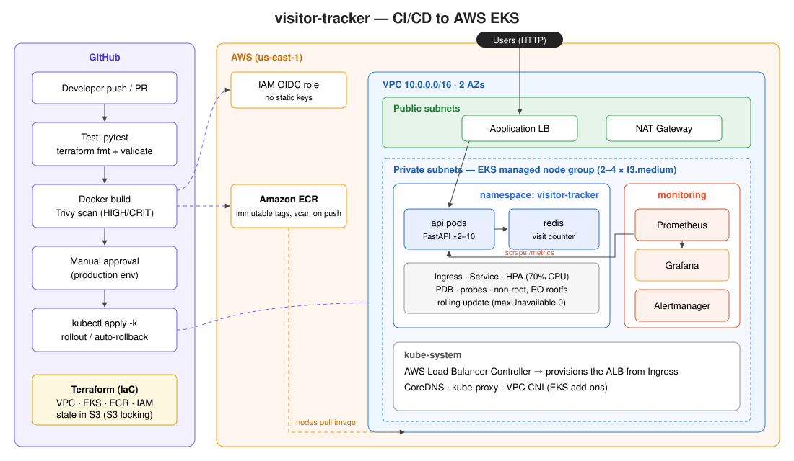
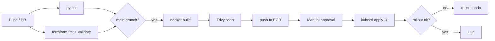

# visitor-tracker — 2-tier app on AWS EKS with Terraform and CI/CD

A containerized FastAPI visitor tracker with Redis, deployed to **Amazon EKS**.
Infrastructure is built with **Terraform** (and, as a first pass, by hand in the AWS Console);
**GitHub Actions** tests, scans and deploys every change with a manual approval gate and automatic
rollback, and **Prometheus + Grafana** monitor it.



## What this demonstrates

| Area | Implementation |
|---|---|
| Infrastructure as Code | Terraform, split by concern: VPC (public/private subnets, 2 AZs, NAT), EKS managed node group and add-ons, ECR, IAM (GitHub OIDC, Load Balancer Controller via Pod Identity). Remote state in S3 with native S3 locking, bootstrapped by its own small Terraform config |
| Web interface | Dashboard served by FastAPI at `/`: live visit count, serving pod, Redis health, request log showing load balancing across pods |
| Containers | Multi-stage Dockerfile, non-root user, healthcheck, slim base image |
| Kubernetes | Deployment, Service, Ingress (ALB), HPA, PodDisruptionBudget, readiness/liveness probes, resource limits, read-only root FS |
| CI/CD | GitHub Actions: unit tests, `terraform fmt/validate`, Docker build, Trivy vulnerability scan, push to ECR, manual approval gate, deploy, rollout check with automatic rollback |
| Security | GitHub → AWS via OIDC (no long-lived access keys), least-privilege CI policy, immutable image tags, scan-on-push, image scanning gate in CI |
| Observability | `/metrics` endpoint (Prometheus client), ServiceMonitor, PrometheusRule alerts, Grafana via kube-prometheus-stack |
| Reliability | Zero-downtime rolling updates, autoscaling 2→10 pods, graceful degradation when Redis is down |

## Pipeline flow



## Repository layout

```
Dockerfile            Container image build (context: project root)
app/                  FastAPI service + web UI (static/), tests
terraform/            Infrastructure as code (attempt 2)
  bootstrap/          S3 bucket for remote state (run once, first)
  policies/           Load Balancer Controller IAM policy (JSON)
  versions.tf         Versions + S3 backend      providers.tf  AWS provider + default tags
  variables.tf        Settings                   vpc.tf        VPC, subnets, NAT
  ecr.tf              Image repository           eks.tf        Cluster, add-ons, nodes, access
  iam-github.tf       GitHub OIDC + CI role      iam-lbc.tf    LB Controller role + Pod Identity
  outputs.tf          Values printed after apply
k8s/                  Kustomize manifests (api, redis, ingress, HPA, PDB)
monitoring/           ServiceMonitor, alert rules, add-on install script
.github/workflows/    CI/CD pipeline
docs/                 Architecture diagrams, console deploy guide, Docker guide
docker-compose.yml    Local dev environment
```

## Run locally

New to Docker? [docs/docker-guide.md](docs/docker-guide.md) explains the Dockerfile, Docker Compose and the build commands in simple English, with practice steps.

```bash
docker compose up --build
```

Open **http://localhost:8000** for the web interface: it shows the visit count, which pod served each
request, and Redis health. Click **Send 10 requests** after deploying to EKS to watch the load balancer
spread traffic across pods.

The JSON API is still there for scripts:

```bash
curl -X POST localhost:8000/api/visit   # {"message": ..., "visits": 1, "pod": ..., "version": "local"}
```

Interactive API docs are at http://localhost:8000/docs.

Run the tests:

```bash
cd app && pip install -r requirements.txt && pytest -q
```

## Deploy to AWS

Two ways to build the same infrastructure, both covered step by step in [docs/console-deploy-guide.md](docs/console-deploy-guide.md) (track progress in [PROJECT_PROGRESS.md](PROJECT_PROGRESS.md)):

- **Attempt 1 · AWS Console (Steps 1–31):** every resource created by hand, each step with a Verify checklist.
- **Attempt 2 · Terraform (Steps T1–T16):** set up remote state, write each `.tf` file (code and plain-English explanations are in the guide), then plan, apply, deploy through the pipeline and destroy.

> ⚠️ EKS + NAT Gateway + ALB cost roughly **$6–7/day**. Tear everything down when you're done (Step 30 or Step T16).

Quick reference once the Terraform code is written:

```bash
cd terraform/bootstrap && terraform init && terraform apply   # once: state bucket
cd .. && terraform init && terraform plan -out=tfplan && terraform apply tfplan
$(terraform output -raw kubeconfig_command)
cd .. && GRAFANA_PASSWORD=change-me ./monitoring/install.sh
```

## Ideas to extend it

- GitOps with **Argo CD** instead of `kubectl apply` from CI
- **Helm chart** for the app, with per-environment values (dev/staging/prod)
- **External Secrets Operator** + AWS Secrets Manager; swap in-cluster Redis for **ElastiCache**
- **Karpenter** for node autoscaling; **cert-manager** + Route 53 for HTTPS
- Policy-as-code with **Checkov/tfsec** in CI and **Kyverno** in-cluster
- Load test with **k6** and show the HPA scaling in Grafana

## Resume bullets

- Designed and provisioned AWS infrastructure (VPC, EKS, ECR, IAM) with Terraform modules and remote state locking.
- Built a GitHub Actions CI/CD pipeline with automated tests, container vulnerability scanning (Trivy), manual approval gates, and automatic rollback on failed rollouts.
- Eliminated static cloud credentials in CI by federating GitHub Actions to AWS with OIDC and least-privilege IAM.
- Deployed a horizontally autoscaled service on Kubernetes with zero-downtime rolling updates, PDBs, and health probes.
- Implemented observability with Prometheus, Grafana, and alerting rules for availability and resource saturation.
