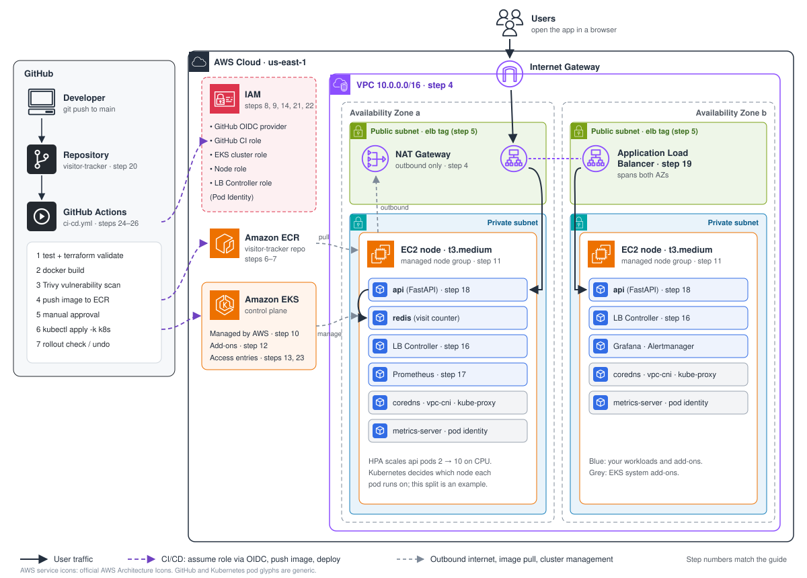

# visitor-tracker: Infrastructure Guide

This project builds the same AWS infrastructure twice:

- **Attempt 1 · AWS Console (Steps 1–31):** you create every piece by hand.
- **Attempt 2 · Terraform (Steps T1–T16):** you write the Terraform code yourself, file by file, then build, deploy and destroy everything with a few commands.

Doing it by hand first teaches you what each Terraform resource really is, but it's optional. **To go straight to Terraform**, do Phase 0 (Steps 1–3), then jump to Step T1. The Terraform steps include everything you need from the console part.

### What you're building



How a request flows: a user's browser reaches the **Internet Gateway**, then the **Application Load Balancer** in the public subnets, which forwards to the **api pods** on EC2 nodes in the private subnets. The api pods store the visit count in **redis**. The nodes have no public IPs; they reach the internet (for example to pull images from **ECR**) only outbound, through the **NAT Gateway**. The **EKS control plane** is run by AWS outside your VPC and manages the nodes.

How a deploy flows: you push to GitHub, **GitHub Actions** gets temporary AWS credentials by assuming an **IAM role through OIDC**, pushes the image to **ECR**, waits for your approval, then tells **EKS** to roll out the new version.

The small "step" numbers on the diagram show which step of this guide creates each piece. AWS service icons come from the official [AWS Architecture Icons](https://aws.amazon.com/architecture/icons/) pack.

### How to use this guide

Work through one step at a time. Each step has a goal, the exact clicks or commands, and a **Verify** checklist. Don't move on until every Verify item passes. Record the evidence in `PROJECT_PROGRESS.md`.

**Names used throughout.** Use these exact names, because the CI/CD pipeline and the Kubernetes files expect them:

| Thing | Name |
|---|---|
| Region | `us-east-1` (N. Virginia) |
| VPC | `visitor-tracker-vpc` |
| ECR repository | `visitor-tracker` |
| EKS cluster | `visitor-tracker-eks` |
| Node group | `visitor-tracker-nodes` |
| Cluster IAM role | `visitor-tracker-eks-cluster-role` |
| Node IAM role | `visitor-tracker-eks-node-role` |
| Load Balancer Controller role | `visitor-tracker-lbc-role` |
| GitHub Actions role | `visitor-tracker-github-ci` |
| GitHub repository | `visitor-tracker` |

**Cost.** From step 10 (EKS cluster) until teardown, expect about **$6–7 per day**: EKS control plane $0.10/h, 2 × t3.medium about $0.08/h, NAT Gateway about $0.045/h plus data, ALB about $0.025/h. Plan to finish in one or two days and do the teardown in Phase 9 as soon as you're done.

# Phase 0 · Prepare

## Step 1 · Install and check your local tools

**Goal:** have every command-line tool the project needs.

**Time:** 10 min · **Cost:** free

You already have Docker, Git, the AWS CLI and Terraform from the 2048 project. This project also needs `kubectl`, which talks to Kubernetes, and `helm`, which installs packaged apps into Kubernetes.

1. Install the two new tools with Homebrew:

```bash
brew install kubectl helm
```

2. Check every tool:

```bash
docker --version && docker info --format '{{.ServerVersion}}'
git --version
aws --version
kubectl version --client
helm version --short
```

If `docker info` fails, start Docker Desktop and run it again.

3. Check the app still works locally. (For how the Docker files work, and practice building the image step by step, see `docs/docker-guide.md`.) From the `visitor-tracker` folder:

```bash
docker compose up --build -d
```

Open http://localhost:8000 and click **Send a request**. Then stop it:

```bash
docker compose down
```

### Verify
- [ ] All five tools print a version
- [ ] The web page loads locally and the visit count goes up

## Step 2 · Create a budget alert

**Goal:** get an email before costs surprise you.

**Time:** 5 min · **Cost:** free (the first two budgets are free)

1. In the console, search for **Billing and Cost Management** → **Budgets** → **Create budget**.
2. Choose **Use a template (simplified)** → **Monthly cost budget**.
3. Budget name: `visitor-tracker-budget`. Amount: `25` (USD).
4. Email recipients: your email. Click **Create budget**.

> **Tip:** AWS sends alerts at 85% and 100% of actual spend, and when forecast spend passes 100%.

### Verify
- [ ] The budget is listed with status OK

## Step 3 · Confirm your AWS identity and set shell variables

**Goal:** make sure the console and your terminal use the same account, and set variables the later commands use.

**Time:** 5 min · **Cost:** free

1. In the console's top-right corner, switch the region to **US East (N. Virginia) us-east-1**. Check this whenever you open a new console tab.
2. Check which identity your terminal uses:

```bash
aws sts get-caller-identity
```

Note the **Account** and the **Arn** (for example `arn:aws:iam::123456789012:user/shams-terraform001`).

3. In the console, click your name (top right) and check the account ID matches. Note which IAM user or role you're signed in as. If the console identity differs from the terminal identity, you'll fix that in Step 13.

> **Warning:** don't do this project while signed in as the root user. Use an IAM user or IAM Identity Center user with admin permissions.

4. Set these variables. **Paste this block again whenever you open a new terminal window**, because later steps rely on it:

```bash
export AWS_REGION=us-east-1
export CLUSTER=visitor-tracker-eks
export ACCOUNT_ID=$(aws sts get-caller-identity --query Account --output text)
export REPO_URI=$ACCOUNT_ID.dkr.ecr.$AWS_REGION.amazonaws.com/visitor-tracker
echo "$ACCOUNT_ID  $REPO_URI"
```

### Verify
- [ ] Console and terminal show the same 12-digit account ID
- [ ] The `echo` prints your account ID and the repository URI

# Phase 1 · Network

## Step 4 · Create the VPC

**Goal:** a private network with public subnets (for the load balancer and NAT) and private subnets (for Kubernetes nodes) across two Availability Zones.

**Time:** 10 min (NAT Gateway takes about 3 min) · **Cost:** the NAT Gateway starts billing now, about $1.10/day

1. Console → **VPC** → **Your VPCs** → **Create VPC**.
2. Choose **VPC and more**. This wizard creates subnets, route tables, the Internet Gateway and the NAT Gateway together.
3. Fill in:
   - **Name tag auto-generation:** `visitor-tracker` (the wizard names everything `visitor-tracker-…`)
   - **IPv4 CIDR block:** `10.0.0.0/16`
   - **IPv6:** No IPv6 CIDR block
   - **Tenancy:** Default
   - **Number of Availability Zones:** `2`
   - **Number of public subnets:** `2`
   - **Number of private subnets:** `2`
   - **NAT gateways:** **In 1 AZ** (one NAT saves money; production would use one per AZ)
   - **VPC endpoints:** **None** (the S3 gateway endpoint is free and fine to keep, but None keeps this simple)
   - **DNS options:** keep both **Enable DNS hostnames** and **Enable DNS resolution** ticked. EKS needs them.
4. Look at the **Preview** diagram on the right: 1 VPC, 4 subnets, 3 route tables, 1 Internet Gateway, 1 NAT Gateway.
5. Click **Create VPC** and wait until every line shows a green tick.

**What you just built.** Public subnets route `0.0.0.0/0` to the Internet Gateway. Private subnets route `0.0.0.0/0` to the NAT Gateway, so nodes can download images without being reachable from the internet.

### Verify
- [ ] **Your VPCs** shows `visitor-tracker-vpc` with CIDR `10.0.0.0/16`
- [ ] **Subnets** shows 4 subnets: 2 with `public` in the name, 2 with `private`, spread over 2 AZs
- [ ] **NAT gateways** shows one gateway with state **Available**

## Step 5 · Tag the subnets for load balancers

**Goal:** tell the AWS Load Balancer Controller which subnets to put the internet-facing load balancer in.

**Time:** 5 min · **Cost:** free

The controller looks for these tags. Without them, the Ingress in Step 19 never gets an address.

1. **VPC** → **Subnets**. Filter by VPC `visitor-tracker-vpc`.
2. For **each public subnet**: select it → **Tags** tab → **Manage tags** → **Add new tag**:
   - Key `kubernetes.io/role/elb`, Value `1` → **Save**
3. For **each private subnet**, add:
   - Key `kubernetes.io/role/internal-elb`, Value `1` → **Save**

### Verify
- [ ] Both public subnets have `kubernetes.io/role/elb = 1`
- [ ] Both private subnets have `kubernetes.io/role/internal-elb = 1`

# Phase 2 · Container registry

## Step 6 · Create the ECR repository

**Goal:** a private registry to store the app's Docker images.

**Time:** 3 min · **Cost:** about $0.10 per GB per month of stored images

1. Console → **Elastic Container Registry** → **Private registry** → **Repositories** → **Create repository**.
2. Fill in:
   - **Repository name:** `visitor-tracker`
   - **Image tag mutability:** **Immutable** (a tag can never be overwritten, so a deployed tag always means the same image)
   - **Encryption:** AES-256 (default)
3. Click **Create**.
4. Turn on scanning. Open **Private registry** → **Features & Settings** → **Scanning** → **Edit**. Choose **Basic scanning** and add a filter `*` with **Scan on push**. **Save**.
5. Add a lifecycle rule so old images are deleted. Open the repository → **Lifecycle policy** (left menu) → **Create rule**:
   - Rule priority `1`, description `Keep last 20 images`
   - Image status **Any**, match criteria **Image count more than** `20` → **Save**

### Verify
- [ ] The repository URI matches the `$REPO_URI` you echoed in Step 3
- [ ] Tag immutability shows **Immutable**
- [ ] One lifecycle rule exists

## Step 7 · Build and push the first image by hand

**Goal:** prove you can push to ECR. Later, GitHub Actions does this automatically.

**Time:** 10 min · **Cost:** free

> **Important for Apple Silicon Macs:** your Mac is `arm64`, but t3.medium nodes are `x86_64` (`amd64`). You must build with `--platform linux/amd64`, or the pods crash with `exec format error`.

1. Log Docker in to ECR (the login lasts 12 hours):

```bash
aws ecr get-login-password --region $AWS_REGION | docker login --username AWS --password-stdin $ACCOUNT_ID.dkr.ecr.$AWS_REGION.amazonaws.com
```

2. From the `visitor-tracker` folder, build for amd64 and push:

```bash
docker buildx build --platform linux/amd64 -t $REPO_URI:manual-1 --push .
```

3. In the console, open the repository and refresh.

### Verify
- [ ] Docker printed `Login Succeeded`
- [ ] The repository shows an image tagged `manual-1`
- [ ] After a minute, the **Vulnerabilities** column shows a scan result (open it to see findings)

# Phase 3 · IAM roles for EKS

## Step 8 · Create the EKS cluster role

**Goal:** a role the EKS control plane uses to manage AWS resources for your cluster.

**Time:** 3 min · **Cost:** free

1. Console → **IAM** → **Roles** → **Create role**.
2. **Trusted entity type:** AWS service. **Service or use case:** **EKS** → use case **EKS - Cluster** → **Next**.
3. The policy `AmazonEKSClusterPolicy` is already selected → **Next**.
4. **Role name:** `visitor-tracker-eks-cluster-role` → **Create role**.

### Verify
- [ ] The role exists, has `AmazonEKSClusterPolicy`, and its **Trust relationships** tab lists `eks.amazonaws.com`

## Step 9 · Create the node role

**Goal:** a role the worker EC2 instances use to join the cluster, pull images from ECR and manage pod networking.

**Time:** 3 min · **Cost:** free

1. **IAM** → **Roles** → **Create role**.
2. **Trusted entity type:** AWS service. **Use case:** **EC2** → **Next**.
3. Search for and tick all three policies:
   - `AmazonEKSWorkerNodePolicy`
   - `AmazonEC2ContainerRegistryReadOnly`
   - `AmazonEKS_CNI_Policy`
4. **Next** → **Role name:** `visitor-tracker-eks-node-role` → **Create role**.

### Verify
- [ ] The role has exactly those three policies and trusts `ec2.amazonaws.com`

# Phase 4 · EKS cluster

## Step 10 · Create the EKS cluster

**Goal:** the Kubernetes control plane.

**Time:** 5 min of clicking + 10–15 min waiting · **Cost:** $0.10/hour starts now

1. Console → **Elastic Kubernetes Service** → **Clusters** → **Create cluster**.
2. Choose **Custom configuration**, and turn **EKS Auto Mode off**.

> **Why not Auto Mode?** Auto Mode manages nodes and load balancers for you, which hides the parts this project is meant to teach. It also uses a different Ingress class than the `alb` class in `k8s/ingress.yaml`, and it wouldn't match the Terraform in attempt 2.

3. **Configure cluster** page:
   - **Name:** `visitor-tracker-eks`
   - **Cluster IAM role:** `visitor-tracker-eks-cluster-role`
   - **Kubernetes version:** pick **1.35** if it is listed in standard support. It matches your kubectl (v1.34, which supports clusters up to one minor version newer) and the Terraform code in attempt 2. If 1.35 is only available in *extended support*, pick the newest version instead and upgrade kubectl first (`brew install kubectl`). Never pick a version marked *extended support*, because that costs 6× more per hour.
   - **Upgrade policy:** Standard
   - **Cluster access** → **Bootstrap cluster administrator access:** **Allow** (this makes *your console identity* a cluster admin). **Cluster authentication mode:** **EKS API**.
   - Leave secrets encryption off. Click **Next**.
4. **Specify networking** page:
   - **VPC:** `visitor-tracker-vpc`
   - **Subnets:** select the **two private subnets** only (remove the public ones if they're pre-selected)
   - **Security groups:** leave empty (EKS creates a cluster security group)
   - **IP address family:** IPv4
   - **Cluster endpoint access:** **Public and private** → **Next**
5. **Configure observability:** leave defaults (no control-plane logging, to avoid CloudWatch costs) → **Next**.
6. **Select add-ons:** make sure these five are ticked:
   - `Amazon VPC CNI`, `CoreDNS`, `kube-proxy` (core networking)
   - `Amazon EKS Pod Identity Agent` (gives the load balancer controller its AWS permissions in Step 15)
   - `Metrics Server` (the autoscaler in `k8s/api.yaml` reads CPU usage from it)

   Untick anything else (such as Node monitoring agent or CloudWatch Observability) → **Next**.
7. **Configure selected add-ons settings:** keep default versions → **Next** → **Create**.

The status shows **Creating**. Step 11 needs the cluster to be **Active**, so take a break while it builds.

### Verify
- [ ] Cluster status becomes **Active** (10–15 min)
- [ ] **Overview** shows the Kubernetes version you picked, marked standard support
- [ ] **Networking** tab shows `visitor-tracker-vpc` and the two private subnets

## Step 11 · Create the node group

**Goal:** two EC2 worker nodes where your pods run.

**Time:** 5 min of clicking + 3–5 min waiting · **Cost:** about $0.08/hour for 2 × t3.medium

The cluster must be **Active** first.

1. Open the cluster → **Compute** tab → **Add node group**.
2. **Configure node group:**
   - **Name:** `visitor-tracker-nodes`
   - **Node IAM role:** `visitor-tracker-eks-node-role` → **Next**
3. **Set compute and scaling configuration:**
   - **AMI type:** **Amazon Linux 2023 (x86_64) Standard**
   - **Capacity type:** On-Demand
   - **Instance types:** remove the default and choose `t3.medium`
   - **Disk size:** `20` GiB
   - **Scaling:** Desired `2`, Minimum `2`, Maximum `4`
   - **Maximum unavailable:** Number `1` → **Next**
4. **Specify networking:** subnets = the **two private subnets** only. Leave **Configure remote access** off → **Next** → **Create**.

> **Note:** "Maximum 4" only sets a ceiling. Nodes are added automatically only if you install Cluster Autoscaler or Karpenter, which this project leaves as an extension. To add nodes by hand, edit **Desired size**.

### Verify
- [ ] Node group status becomes **Active**
- [ ] **Compute** tab → **Nodes** lists 2 nodes, status **Ready**
- [ ] **EC2** → **Instances** shows 2 running t3.medium instances with private IPs only

## Step 12 · Check the add-ons

**Goal:** confirm the five add-ons are running now that nodes exist.

**Time:** 2 min · **Cost:** free

1. Cluster → **Add-ons** tab.
2. Each of the five add-ons from Step 10 should show **Active**. CoreDNS and Metrics Server stay **Degraded** or **Creating** until nodes exist, then turn Active.
3. If one is missing: **Get more add-ons** → tick it → **Next** → **Next** → **Create**.

### Verify
- [ ] `vpc-cni`, `coredns`, `kube-proxy`, `eks-pod-identity-agent` and `metrics-server` are all **Active**

## Step 13 · Connect kubectl to the cluster

**Goal:** control the cluster from your terminal.

**Time:** 5 min · **Cost:** free

1. Write the cluster's connection details into `~/.kube/config`:

```bash
aws eks update-kubeconfig --region $AWS_REGION --name $CLUSTER
```

2. Test it:

```bash
kubectl get nodes
kubectl get pods -A
```

**If you get `the server has asked for the client to provide credentials`:** your terminal identity isn't the identity that created the cluster (see Step 3). Give it access:

   1. Cluster → **Access** tab → **IAM access entries** → **Create access entry**.
   2. **IAM principal ARN:** the Arn from `aws sts get-caller-identity`. **Type:** Standard → **Next**.
   3. **Policy name:** `AmazonEKSClusterAdminPolicy`, **Access scope:** Cluster → **Add policy** → **Next** → **Create**.
   4. Run `kubectl get nodes` again.

3. Check Metrics Server works (the numbers can take a minute to appear):

```bash
kubectl top nodes
```

### Verify
- [ ] `kubectl get nodes` lists 2 nodes in `Ready` state
- [ ] `kubectl get pods -A` shows `aws-node`, `kube-proxy`, `coredns`, `eks-pod-identity-agent` and `metrics-server` pods `Running`
- [ ] `kubectl top nodes` shows CPU and memory for both nodes

# Phase 5 · Cluster add-ons

## Step 14 · Create the IAM policy and role for the Load Balancer Controller

**Goal:** AWS permissions that let the controller create Application Load Balancers.

**Time:** 10 min · **Cost:** free

The AWS Load Balancer Controller runs inside the cluster. It watches `Ingress` objects and creates a real ALB for each one, so it needs IAM permissions.

1. Download the official policy document and copy it to your clipboard:

```bash
curl -fsSL -o /tmp/lbc_iam_policy.json https://raw.githubusercontent.com/kubernetes-sigs/aws-load-balancer-controller/main/docs/install/iam_policy.json
pbcopy < /tmp/lbc_iam_policy.json
```

2. Console → **IAM** → **Policies** → **Create policy** → **JSON** tab. Select all the existing text and paste. **Next**.
3. **Policy name:** `AWSLoadBalancerControllerIAMPolicy` → **Create policy**.
4. **IAM** → **Roles** → **Create role**:
   - **Trusted entity type:** AWS service → **Use case:** **EKS** → **EKS - Pod Identity** → **Next**
   - Search for and tick `AWSLoadBalancerControllerIAMPolicy` → **Next**
   - **Role name:** `visitor-tracker-lbc-role` → **Create role**

### Verify
- [ ] The policy `AWSLoadBalancerControllerIAMPolicy` exists
- [ ] The role `visitor-tracker-lbc-role` trusts `pods.eks.amazonaws.com` and has that policy

## Step 15 · Link the role to the controller with Pod Identity

**Goal:** give the controller's Kubernetes service account the IAM role, with no access keys involved.

**Time:** 3 min · **Cost:** free

1. EKS → your cluster → **Access** tab → **Pod Identity associations** → **Create**.
2. Fill in:
   - **IAM role:** `visitor-tracker-lbc-role`
   - **Kubernetes namespace:** `kube-system`
   - **Kubernetes service account:** `aws-load-balancer-controller` (it doesn't exist yet; Helm creates it in the next step with this exact name)
3. **Create**.

### Verify
- [ ] The association is listed for `kube-system` / `aws-load-balancer-controller`

## Step 16 · Install the AWS Load Balancer Controller

**Goal:** the controller running in the cluster.

**Time:** 5 min · **Cost:** free

```bash
export VPC_ID=$(aws eks describe-cluster --name $CLUSTER --query cluster.resourcesVpcConfig.vpcId --output text)
helm repo add eks https://aws.github.io/eks-charts
helm repo update
helm install aws-load-balancer-controller eks/aws-load-balancer-controller \
  --namespace kube-system \
  --set clusterName=$CLUSTER \
  --set serviceAccount.name=aws-load-balancer-controller \
  --set region=$AWS_REGION \
  --set vpcId=$VPC_ID
```

Check it:

```bash
kubectl -n kube-system get deploy aws-load-balancer-controller
kubectl -n kube-system logs deploy/aws-load-balancer-controller | tail -5
```

### Verify
- [ ] The deployment shows `2/2` ready
- [ ] The logs show no `AccessDenied` errors (if they do, re-check Steps 14–15, then run `kubectl -n kube-system rollout restart deploy/aws-load-balancer-controller`)

## Step 17 · Install Prometheus and Grafana

**Goal:** monitoring in place before the app arrives, so the app's `ServiceMonitor` can register.

**Time:** 5 min · **Cost:** free (it runs on your existing nodes)

`kube-prometheus-stack` installs Prometheus, Grafana, Alertmanager and the custom resource types `ServiceMonitor` and `PrometheusRule` that the project's files use.

1. Pick a Grafana password and install:

```bash
helm repo add prometheus-community https://prometheus-community.github.io/helm-charts
helm repo update
helm install monitoring prometheus-community/kube-prometheus-stack \
  --namespace monitoring --create-namespace \
  --set grafana.adminPassword='choose-a-password'
```

2. Add the project's alert rules (they live in the app's namespace, so create it first):

```bash
kubectl create namespace visitor-tracker
kubectl apply -f monitoring/alerts.yaml
```

### Verify
- [ ] `kubectl -n monitoring get pods` shows all pods `Running` (about 2 minutes)
- [ ] `kubectl -n visitor-tracker get prometheusrules` lists `api-alerts`

# Phase 6 · First deployment by hand

## Step 18 · Deploy the app with kubectl

**Goal:** run the app on EKS using the `manual-1` image from Step 7.

**Time:** 5 min · **Cost:** the ALB starts billing, about $0.60/day

`k8s/api.yaml` contains `IMAGE_PLACEHOLDER` and `VERSION_PLACEHOLDER`, which the pipeline fills in. By hand, render the files, fill the placeholders on the fly and apply. Your files don't change.

From the `visitor-tracker` folder:

```bash
kubectl kustomize k8s \
  | sed "s#IMAGE_PLACEHOLDER#$REPO_URI:manual-1#; s#VERSION_PLACEHOLDER#manual-1#" \
  | kubectl apply -f -
```

Watch the pods start:

```bash
kubectl -n visitor-tracker get pods -w
```

Press Ctrl+C when `api` (2 pods) and `redis` (1 pod) are all `1/1 Running`.

> **If pods show `CrashLoopBackOff` with `exec format error`:** the image was built for arm64. Rebuild it as in Step 7 with `--platform linux/amd64` and a new tag (`manual-2`), then apply again with that tag.

### Verify
- [ ] 2 `api` pods and 1 `redis` pod are `Running` and `1/1` ready
- [ ] `kubectl -n visitor-tracker get hpa` shows a CPU percentage, not `<unknown>` (wait a minute)

## Step 19 · Open the app in your browser

**Goal:** see it live on the internet.

**Time:** 5 min (the ALB takes 2–4 min to provision) · **Cost:** included above

1. Get the load balancer address:

```bash
kubectl -n visitor-tracker get ingress api
```

The `ADDRESS` column fills in with something like `k8s-api-…elb.amazonaws.com`.

2. In the console, **EC2** → **Load Balancers** shows the new ALB. Wait until its state is **Active**.
3. Open `http://<ADDRESS>` in your browser.
4. Click **Send 10 requests** and watch the **Pod** column. With two pods behind the load balancer, you should see two different pod names.

> **If ADDRESS stays empty:** run `kubectl -n visitor-tracker describe ingress api` and `kubectl -n kube-system logs deploy/aws-load-balancer-controller`. The usual cause is missing subnet tags (Step 5).

### Verify
- [ ] The dashboard loads from the ALB address, with a green **Ready** badge
- [ ] Version shows `manual-1`
- [ ] "Pods seen so far" shows 2 different pods

# Phase 7 · CI/CD with GitHub Actions

## Step 20 · Check the GitHub repository

**Goal:** confirm the repository the pipeline runs in.

**Time:** 3 min · **Cost:** free

The repository already exists and holds the code: **https://github.com/masumshamsur/visitor-tracker** (public). A public repo is good for a portfolio, and required reviewers on environments (Step 24) are free only on public repos with a free GitHub plan.

1. Open the repo and check the code and README are there.
2. Open the **Actions** tab. Each push so far ran the **ci-cd** workflow: `preflight` and `test` run, and the other jobs show as **skipped**. That's expected: `terraform-check` waits for a `terraform/` folder, and `build-scan-push` and `deploy` wait for the AWS secret you add in Step 24.
3. Your full repo name is `masumshamsur/visitor-tracker`. Steps 22 and T5 use it.

### Verify
- [ ] The repository shows the project files and README
- [ ] The latest **ci-cd** run is green, with `preflight` and `test` passed and the other jobs skipped

## Step 21 · Add GitHub as an identity provider in IAM

**Goal:** let AWS trust short-lived login tokens issued by GitHub Actions (OIDC), so you never store AWS access keys in GitHub.

**Time:** 3 min · **Cost:** free

1. Console → **IAM** → **Identity providers** → **Add provider**.
2. **Provider type:** OpenID Connect.
3. **Provider URL:** `https://token.actions.githubusercontent.com`
4. **Audience:** `sts.amazonaws.com`
5. **Add provider**.

> **Note:** an account can have only one provider per URL. If it already exists, skip this step and reuse it.

### Verify
- [ ] `token.actions.githubusercontent.com` is listed under Identity providers

## Step 22 · Create the GitHub Actions role

**Goal:** the role the pipeline assumes. It can push to your ECR repository and look up your cluster, and nothing else.

**Time:** 10 min · **Cost:** free

1. **IAM** → **Roles** → **Create role**.
2. **Trusted entity type:** **Web identity**.
   - **Identity provider:** `token.actions.githubusercontent.com`
   - **Audience:** `sts.amazonaws.com`
   - **GitHub organization:** `masumshamsur`
   - **GitHub repository:** `visitor-tracker`
   - **GitHub branch:** `main` → **Next**
3. Skip adding permissions → **Next**. **Role name:** `visitor-tracker-github-ci` → **Create role**.
4. **Fix the trust policy.** The deploy job uses the `production` environment, and GitHub then identifies it as `environment:production` instead of the branch. Open the role → **Trust relationships** → **Edit trust policy**. Replace the `token.actions.githubusercontent.com:sub` condition so it allows both values:

```json
"StringLike": {
  "token.actions.githubusercontent.com:sub": [
    "repo:masumshamsur/visitor-tracker:ref:refs/heads/main",
    "repo:masumshamsur/visitor-tracker:environment:production"
  ]
}
```

   Keep the `StringEquals` condition for `aud` as it is → **Update policy**.

5. **Add permissions.** **Permissions** tab → **Add permissions** → **Create inline policy** → **JSON**. Paste this, with your 12-digit account ID in place of `ACCOUNT_ID`:

```json
{
  "Version": "2012-10-17",
  "Statement": [
    {
      "Effect": "Allow",
      "Action": ["ecr:GetAuthorizationToken", "eks:DescribeCluster"],
      "Resource": "*"
    },
    {
      "Effect": "Allow",
      "Action": [
        "ecr:BatchCheckLayerAvailability",
        "ecr:InitiateLayerUpload",
        "ecr:UploadLayerPart",
        "ecr:CompleteLayerUpload",
        "ecr:PutImage",
        "ecr:BatchGetImage"
      ],
      "Resource": "arn:aws:ecr:us-east-1:ACCOUNT_ID:repository/visitor-tracker"
    }
  ]
}
```

   **Next** → **Policy name:** `visitor-tracker-ci-permissions` → **Create policy**.

6. Copy the role's **ARN** from the summary at the top. You need it in Steps 23 and 24.

### Verify
- [ ] The trust policy lists both the `ref:refs/heads/main` and `environment:production` subjects
- [ ] The role has the inline policy `visitor-tracker-ci-permissions`

## Step 23 · Let the GitHub role deploy to the cluster

**Goal:** IAM permissions let the pipeline find the cluster. A separate EKS access entry lets it run `kubectl`.

**Time:** 3 min · **Cost:** free

1. EKS → your cluster → **Access** tab → **IAM access entries** → **Create access entry**.
2. **IAM principal ARN:** the `visitor-tracker-github-ci` role ARN. **Type:** Standard → **Next**.
3. **Policy name:** `AmazonEKSClusterAdminPolicy`. **Access scope:** Cluster → **Add policy** → **Next** → **Create**.

> **Least privilege:** cluster admin keeps this simple, because the pipeline creates a namespace and monitoring objects. A good improvement later is a narrower policy scoped to the `visitor-tracker` namespace.

### Verify
- [ ] The access entry for `visitor-tracker-github-ci` is listed with `AmazonEKSClusterAdminPolicy`

## Step 24 · Add the secret and the production environment in GitHub

**Goal:** tell the pipeline which role to use, and add a manual approval before every deploy.

**Time:** 5 min · **Cost:** free

1. GitHub repo → **Settings** → **Secrets and variables** → **Actions** → **New repository secret**:
   - **Name:** `AWS_CI_ROLE_ARN`
   - **Secret:** the role ARN from Step 22 → **Add secret**
2. **Settings** → **Environments** → **New environment** → name `production` → **Configure environment**.
3. Tick **Required reviewers**, add yourself → **Save protection rules**.

> **Why the `production` environment and required reviewers?** The `deploy` job says `environment: production`, so GitHub pauses it until a listed reviewer clicks **Approve and deploy**. This is the manual approval gate: code is tested, scanned and pushed automatically, but nothing reaches the live cluster until a person says yes. **Save protection rules** is what turns that rule on; if you don't save, the environment exists but has no reviewers, and `deploy` runs straight away. The environment also matters for AWS: the CI role's trust policy accepts the `environment:production` subject, so only this job can deploy. Leave **Prevent self-review** unticked: you're the only reviewer, and ticking it would mean nobody could approve your own pushes.

> **Why this secret?** The pipeline needs AWS access to push the image to ECR and run `kubectl` on EKS. Instead of storing AWS access keys in GitHub, it gets short-lived credentials (about 1 hour) through OIDC. `AWS_CI_ROLE_ARN` tells it **which IAM role** to ask for. AWS only says yes if the request comes from your repo's `main` branch or `production` environment (the role's trust policy). The ARN itself isn't a password; it's stored as a secret to keep your account ID out of the logs. The workflow reads it in the `Configure AWS credentials` step (`role-to-assume: ${{ secrets.AWS_CI_ROLE_ARN }}`), and `preflight` skips the AWS jobs while it's missing.

### Verify
- [ ] The secret `AWS_CI_ROLE_ARN` is listed
- [ ] The `production` environment has you as a required reviewer

## Step 25 · Run the full pipeline

**Goal:** a push to `main` tests, builds, scans and deploys the app automatically.

**Time:** 15 min · **Cost:** free (GitHub Actions minutes are free on public repos)

1. The code is already on GitHub. Now that the secret exists (Step 24), trigger a new run with an empty commit, from the `visitor-tracker` folder:

```bash
git commit --allow-empty -m "Run the pipeline against AWS"
git push
```

2. GitHub → **Actions** tab → open the running **ci-cd** workflow. Watch the jobs:
   - `preflight` checks what's set up. It now finds the AWS secret, so the build and deploy jobs will run
   - `test` runs the unit tests (`terraform-check` stays skipped until attempt 2 adds the `terraform/` folder)
   - `build-scan-push` builds the image, scans it with Trivy and pushes it to ECR tagged with the short commit SHA
   - `deploy` pauses with **Waiting for review**
3. Click **Review deployments** → tick `production` → **Approve and deploy**.
4. `deploy` applies the manifests and waits for the rollout.

> **If `build-scan-push` fails at "Configure AWS credentials":** check the secret value and the trust policy username (Step 22). **If it fails at the Trivy scan:** the base image has a fixable HIGH or CRITICAL vulnerability. Read the table in the log. Usually a newer `python:3.12-slim` fixes it.

### Verify
- [ ] `preflight`, `test`, `build-scan-push` and `deploy` are green (`terraform-check` skipped)
- [ ] ECR shows a new image tagged with a 7-character commit SHA
- [ ] `kubectl -n visitor-tracker get deploy api -o jsonpath='{.spec.template.spec.containers[0].image}'` prints the SHA-tagged image

## Step 26 · Ship a change through the pipeline

**Goal:** the full loop: edit code, push, approve, see it live.

**Time:** 10 min · **Cost:** free

1. Make a visible change. For example, in `app/static/index.html` change the subtitle text, or in `app/main.py` change `"Hello from visitor-tracker"`.
2. Commit and push:

```bash
git add -A
git commit -m "Change dashboard subtitle"
git push
```

3. Approve the deploy in GitHub Actions, as in Step 25.
4. Refresh the ALB address in your browser.

### Verify
- [ ] The **Version** card shows the new commit SHA
- [ ] Your change is visible
- [ ] The page stayed up throughout the rollout (zero downtime from `maxUnavailable: 0`)

# Phase 8 · Prove it works

## Step 27 · Look at metrics in Prometheus and Grafana

**Goal:** see the app's own metrics in a dashboard.

**Time:** 10 min · **Cost:** free

1. Open Prometheus (keep this terminal running):

```bash
kubectl -n monitoring port-forward svc/monitoring-kube-prometheus-prometheus 9090
```

   Go to http://localhost:9090 → **Status** → **Targets**. Find `serviceMonitor/visitor-tracker/api` with 2 endpoints **UP**. In **Query**, run `sum(rate(app_requests_total[5m])) by (endpoint)`.

2. Open Grafana in another terminal:

```bash
kubectl -n monitoring port-forward svc/monitoring-grafana 3000:80
```

   Go to http://localhost:3000, log in as `admin` with the password from Step 17. Open **Dashboards** → **Kubernetes / Compute Resources / Namespace (Pods)** → namespace `visitor-tracker`.

3. Make a quick app panel: **Explore** → data source Prometheus → query `sum(rate(app_requests_total[1m]))`. Click **Send 10 requests** a few times on the app page and watch the line rise.

### Verify
- [ ] The Prometheus target for the API is UP
- [ ] Grafana shows CPU and memory for the `visitor-tracker` pods
- [ ] The request-rate query rises when you send requests

## Step 28 · Test autoscaling and automatic rollback

**Goal:** prove the HPA adds pods under load, and the pipeline undoes a bad deploy.

**Time:** 20 min · **Cost:** free

**Autoscaling**

1. In one terminal, watch the autoscaler:

```bash
kubectl -n visitor-tracker get hpa api -w
```

2. In another terminal, generate load from inside the cluster:

```bash
kubectl -n visitor-tracker run load --image=busybox:1.36 --restart=Never -- /bin/sh -c "while true; do wget -q -O- --post-data='' http://api/api/visit > /dev/null; done"
```

3. Within 1–3 minutes, CPU goes above 70% and `REPLICAS` climbs above 2. Open the app and send requests: you'll see more pod names. If CPU stays low, start a second load pod named `load2`.
4. Stop the load. The HPA scales back down after about 5 minutes:

```bash
kubectl -n visitor-tracker delete pod load load2 --ignore-not-found
```

**Automatic rollback**

5. Break the readiness probe on purpose. In `k8s/api.yaml`, change `path: /readyz` to `path: /broken`. Commit, push and approve the deploy.
6. New pods never become ready, so the old pods keep serving traffic. After 180 seconds the deploy job runs `rollout undo` and fails (red).
7. Check the page still works, then revert the change:

```bash
git revert --no-edit HEAD
git push
```

   Approve that deploy too.

### Verify
- [ ] The HPA scaled `api` above 2 replicas under load, and back down afterwards
- [ ] The broken deploy failed, the app stayed up the whole time, and the revert deployed green

## Step 29 · Capture your portfolio evidence

**Goal:** screenshots and notes that prove what you built, saved before you tear it down.

**Time:** 20 min · **Cost:** free

Save screenshots into `visitor-tracker/docs/screenshots/`:

- [ ] The app dashboard on the ALB address, showing 2+ pod names
- [ ] GitHub Actions: a green run with all four jobs, and the approval screen
- [ ] EKS console: cluster overview and the node group
- [ ] `kubectl get pods,svc,ingress,hpa -n visitor-tracker` output in the terminal
- [ ] HPA scaling up during the load test
- [ ] The failed and rolled-back deploy job
- [ ] Grafana showing the request rate
- [ ] ECR showing SHA-tagged images and scan results

Then add a **Screenshots** section to the README that links to them, and note any problems you hit (and how you fixed them) in `PROJECT_PROGRESS.md`. Interviewers love those stories.

### Verify
- [ ] Screenshots are saved and linked from the README, then committed and pushed

# Phase 9 · Teardown

## Step 30 · Delete everything, in the right order

**Goal:** stop all charges. The order matters: the load balancer and network interfaces created from inside Kubernetes block VPC deletion if you delete the cluster first.

**Time:** 30 min (mostly waiting) · **Cost:** charges stop

1. **Delete the app.** This removes the ALB:

```bash
kubectl kustomize k8s | sed "s#IMAGE_PLACEHOLDER#x#; s#VERSION_PLACEHOLDER#x#" | kubectl delete -f -
```

   In **EC2** → **Load Balancers**, wait until the `k8s-…` ALB is gone. In **EC2** → **Target Groups**, the `k8s-…` target group should be gone too.

2. **Uninstall the Helm releases:**

```bash
helm -n monitoring uninstall monitoring
helm -n kube-system uninstall aws-load-balancer-controller
```

3. **EKS** → cluster → **Compute** → select `visitor-tracker-nodes` → **Delete**. Wait until it's gone (about 5 min).
4. **EKS** → **Clusters** → select `visitor-tracker-eks` → **Delete**. Wait until it's gone (about 5 min).
5. **VPC** → **NAT gateways** → select the NAT gateway → **Actions** → **Delete NAT gateway**. Wait until its state is **Deleted**.
6. **VPC** → **Elastic IPs** → select the IP the NAT used → **Actions** → **Release Elastic IP addresses**. An unattached Elastic IP still costs money.
7. **VPC** → **Your VPCs** → select `visitor-tracker-vpc` → **Actions** → **Delete VPC**. This deletes its subnets, route tables and Internet Gateway too. If it complains about network interfaces or security groups, check **EC2** → **Network Interfaces** and **Security Groups** for leftovers tagged `k8s` or `eks`, delete them, and try again.
8. **ECR** → select `visitor-tracker` → **Delete** (type `delete` to confirm; this deletes all its images).
9. **IAM** → **Roles**: delete `visitor-tracker-eks-cluster-role`, `visitor-tracker-eks-node-role`, `visitor-tracker-lbc-role` and `visitor-tracker-github-ci`.
10. **IAM** → **Policies**: delete `AWSLoadBalancerControllerIAMPolicy`.
11. **IAM** → **Identity providers**: leave `token.actions.githubusercontent.com` in place. Another project in this account uses it, and the Terraform in attempt 2 reuses it.
12. **CloudWatch** → **Log groups**: delete any `/aws/eks/visitor-tracker-eks/…` groups, if present.
13. Clean up your kubeconfig:

```bash
kubectl config delete-context $(kubectl config current-context)
```

### Verify
- [ ] EC2: no running instances, load balancers, target groups or Elastic IPs from this project
- [ ] EKS: no clusters
- [ ] VPC: only the default VPC remains
- [ ] Billing → **Bills** the next day shows EKS, EC2, NAT and ELB charges have stopped

## Step 31 · Prepare for attempt 2 (Terraform)

**Goal:** know how the console steps map to Terraform, so attempt 2 goes smoothly.

**Time:** 10 min of reading · **Cost:** free

| Console steps | Terraform file (attempt 2) |
|---|---|
| 4–5 VPC and subnet tags | `vpc.tf` (`module "vpc"`, tags included) |
| 6 ECR repository and lifecycle rule | `ecr.tf` |
| 8–9 Cluster and node roles | created inside `module "eks"` in `eks.tf` |
| 10–12 Cluster, add-ons, node group | `eks.tf` (`addons`, `eks_managed_node_groups`) |
| 13 Your admin access | `enable_cluster_creator_admin_permissions = true` in `eks.tf` |
| 14–15 LBC policy, role, Pod Identity | `iam-lbc.tf` + `policies/aws-load-balancer-controller.json` |
| 16–17 Helm installs | `monitoring/install.sh` (Step T14) |
| 21–22 GitHub OIDC and CI role | `iam-github.tf` (looks up the existing GitHub provider, creates the CI role) |
| 23 Access entry for CI | `access_entries.github_ci` in `eks.tf` |

Before attempt 2:

- [ ] Confirm Step 30 is fully done (the GitHub identity provider stays; Terraform reuses it)
- [ ] Continue with Step T1

# Attempt 2 · Terraform setup

## Step T1 · Get ready for the Terraform attempt

**Goal:** start from a clean AWS account and the right tool versions.

**Time:** 10 min · **Cost:** free

In attempt 2 you build the **same infrastructure** as the console steps describe, but written as code. Terraform reads `.tf` files, works out what to create, and creates it in the right order. You write the code yourself, file by file, following Steps T2–T11.

1. Make sure none of this project's AWS resources exist yet. Terraform uses fixed names (`visitor-tracker-eks`, `visitor-tracker-github-ci` and so on) and fails if they already exist.
   - **GitHub identity provider:** check IAM → **Identity providers** for `token.actions.githubusercontent.com`. Your account already has one (from another project), and the code in Step T9 is written to **reuse** it. If an account had none, you'd create it once in the console (Step 21) before running Terraform.
   - **If you did the console steps:** make sure the Step 30 teardown is complete.
2. Check your tools:

```bash
terraform version
aws sts get-caller-identity
kubectl version --client
helm version --short
```

You need **Terraform 1.10 or newer** (for S3 state locking). You have 1.16.

3. Your GitHub repository already exists: https://github.com/masumshamsur/visitor-tracker. Step T15 connects it to AWS.

> **About the Kubernetes version:** the code uses `1.35`. Before you start, open **EKS** → **Create cluster** in the console and check which versions are offered *without* "extended support". If 1.35 is in extended support, use the newest standard version in `variables.tf` (Step T5).

### Verify
- [ ] No `visitor-tracker` resources exist in the account yet
- [ ] IAM → Identity providers lists `token.actions.githubusercontent.com` (reused by Step T9)
- [ ] Kubernetes **1.35** is offered with standard support (until March 26, 2027)
- [ ] `terraform version` shows 1.10 or newer
- [ ] `aws sts get-caller-identity` shows the right account

## Step T2 · Set up the Terraform folder structure

**Goal:** an empty, well-organised folder for your Terraform code.

**Time:** 5 min · **Cost:** free

Create the empty folders (if an older `terraform/` draft is still there, move it aside first with `mv terraform terraform-old`):

```bash
cd ~/Documents/aws/aws-labs/visitor-tracker
mkdir -p terraform/bootstrap terraform/policies
```

This is the structure you'll build. Each file holds one part of the infrastructure, so it's easy to find things:

```
terraform/
├── bootstrap/                  Run once, first: creates the S3 bucket for the state file
│   ├── main.tf                 S3 bucket + versioning + encryption + public-access block
│   └── outputs.tf              Prints the bucket name
├── policies/
│   └── aws-load-balancer-controller.json   Official IAM policy for the controller
├── versions.tf                 Terraform/provider versions + remote state (S3) settings
├── providers.tf                AWS region + tags added to everything
├── variables.tf                Settings you can change (names, region, sizes)
├── terraform.tfvars.example    Example values; you copy it to terraform.tfvars
├── vpc.tf                      VPC, subnets, NAT Gateway, subnet tags   (console Steps 4–5)
├── ecr.tf                      ECR repository + lifecycle rule          (console Step 6)
├── eks.tf                      EKS cluster, add-ons, node group, access (console Steps 8–13, 23)
├── iam-github.tf               GitHub OIDC provider + CI role           (console Steps 21–22)
├── iam-lbc.tf                  Load Balancer Controller role + Pod Identity (console Steps 14–15)
└── outputs.tf                  Useful values printed after "apply"
```

**Two Terraform folders, two state files.** `bootstrap/` keeps its small state file on your laptop. The main `terraform/` folder keeps its state file in the S3 bucket that bootstrap creates.

> **Git:** the project's `.gitignore` already ignores `.terraform/`, `*.tfstate*` and `*.tfvars`. Do commit `.terraform.lock.hcl` when Terraform creates it, because it pins exact provider versions.

### Verify
- [ ] `ls terraform` shows the empty `bootstrap` and `policies` folders

## Step T3 · Create the remote state bucket (bootstrap)

**Goal:** an S3 bucket to hold Terraform's state file.

**Time:** 10 min · **Cost:** a few cents per month

**What is the state file?** After `terraform apply`, Terraform saves a file, `terraform.tfstate`, that maps your code to the real resources in AWS (for example, "module.eks is cluster visitor-tracker-eks"). Next time, Terraform compares code, state and AWS to decide what to change.

**Why keep it in S3 (remote state)?**
- If it's only on your laptop and the laptop dies, Terraform forgets what it built.
- GitHub Actions or a teammate can use the same state.
- **Locking** stops two `terraform apply` runs from changing things at the same time.
- S3 **versioning** keeps old copies, so you can recover from a mistake.

**The chicken-and-egg problem.** Terraform can't store its state in a bucket that doesn't exist yet. So you create the bucket with a tiny separate Terraform setup, `bootstrap/`, which keeps its own state locally.

> **No DynamoDB table needed.** Older guides create a DynamoDB table for locking. Since Terraform 1.10, S3 can lock by itself (`use_lockfile = true`), and DynamoDB locking is deprecated.

1. Create `terraform/bootstrap/main.tf`:

```hcl
terraform {
  required_version = ">= 1.10"

  required_providers {
    aws = {
      source  = "hashicorp/aws"
      version = "~> 6.0"
    }
  }
}

provider "aws" {
  region = "us-east-1"
}

# Your 12-digit account ID, used to make the bucket name unique worldwide.
data "aws_caller_identity" "current" {}

resource "aws_s3_bucket" "tfstate" {
  bucket = "visitor-tracker-tfstate-${data.aws_caller_identity.current.account_id}"

  # Lets "terraform destroy" delete the bucket even when it still holds old state files.
  # Fine for a practice project; leave it out for real work.
  force_destroy = true
}

# Keep every old version of the state file, so a mistake can be undone.
resource "aws_s3_bucket_versioning" "tfstate" {
  bucket = aws_s3_bucket.tfstate.id

  versioning_configuration {
    status = "Enabled"
  }
}

# Encrypt the state file at rest.
resource "aws_s3_bucket_server_side_encryption_configuration" "tfstate" {
  bucket = aws_s3_bucket.tfstate.id

  rule {
    apply_server_side_encryption_by_default {
      sse_algorithm = "AES256"
    }
  }
}

# The state file can contain secrets: never let the bucket become public.
resource "aws_s3_bucket_public_access_block" "tfstate" {
  bucket                  = aws_s3_bucket.tfstate.id
  block_public_acls       = true
  block_public_policy     = true
  ignore_public_acls      = true
  restrict_public_buckets = true
}
```

What it does:
- `data "aws_caller_identity"` looks up your account ID, so the bucket name is unique worldwide (S3 names must be).
- `aws_s3_bucket` creates the bucket `visitor-tracker-tfstate-<your account ID>`.
- The three resources after it switch on **versioning** (old copies kept), **encryption**, and a **public access block** (the state file can contain secrets).

2. Create `terraform/bootstrap/outputs.tf`:

```hcl
output "state_bucket_name" {
  description = "Copy this name into the backend block in terraform/versions.tf"
  value       = aws_s3_bucket.tfstate.bucket
}
```

3. Run it:

```bash
cd ~/Documents/aws/aws-labs/visitor-tracker/terraform/bootstrap
terraform init
terraform plan
terraform apply
```

- `init` downloads the AWS provider (the plugin that talks to AWS).
- `plan` shows what will be created: **4 to add** (the bucket and its three settings). The account lookup is only read, so it isn't counted.
- `apply` shows the plan again and asks you to type `yes`.

4. Note the bucket name from the output (`state_bucket_name`).

### Verify
- [ ] `terraform apply` ends with `Apply complete! Resources: 4 added`
- [ ] **S3** console shows `visitor-tracker-tfstate-<account ID>` with **Bucket Versioning: Enabled** (Properties tab) and **Block all public access: On** (Permissions tab)
- [ ] `terraform/bootstrap/terraform.tfstate` exists on your laptop

## Step T4 · Connect Terraform to the remote state

**Goal:** the main Terraform folder stores its state in your new bucket.

**Time:** 10 min · **Cost:** free

1. Create `terraform/versions.tf`. **Change the bucket name** to the one from Step T3:

```hcl
terraform {
  required_version = ">= 1.10"

  required_providers {
    aws = {
      source  = "hashicorp/aws"
      version = "~> 6.0"
    }
  }

  # Where Terraform keeps its state file: the S3 bucket you created in bootstrap/.
  # Variables are not allowed here, so type your real bucket name.
  backend "s3" {
    bucket       = "visitor-tracker-tfstate-123456789012"
    key          = "visitor-tracker/terraform.tfstate"
    region       = "us-east-1"
    encrypt      = true
    use_lockfile = true # S3 locking: stops two "terraform apply" runs at the same time
  }
}
```

What it does:
- `required_version` and `required_providers` make sure everyone uses compatible versions of Terraform and the AWS provider. `~> 6.0` means "any 6.x".
- `backend "s3"` tells Terraform to keep the state file in your bucket under the path `visitor-tracker/terraform.tfstate`.
- `use_lockfile = true` makes Terraform create a small `.tflock` file next to the state while it works. A second `apply` waits instead of breaking things.
- You can't use variables inside `backend`. That's why the bucket name is typed out in full.

2. Create `terraform/providers.tf`:

```hcl
provider "aws" {
  region = var.region

  # Every AWS resource Terraform creates gets these tags automatically.
  default_tags {
    tags = {
      Project   = var.project
      ManagedBy = "terraform"
    }
  }
}
```

What it does: sets the AWS region, and adds the tags `Project = visitor-tracker` and `ManagedBy = terraform` to **every** resource. That makes your resources easy to find in the console and in your bill.

3. Initialise:

```bash
cd ~/Documents/aws/aws-labs/visitor-tracker/terraform
terraform init
```

### Verify
- [ ] The output says `Successfully configured the backend "s3"!`
- [ ] A `.terraform.lock.hcl` file was created in `terraform/`

# Attempt 2 · Terraform code

## Step T5 · variables.tf and terraform.tfvars

**Goal:** keep the settings you might change in one place.

**Time:** 10 min · **Cost:** free

1. Create `terraform/variables.tf`:

```hcl
variable "project" {
  description = "Name prefix for every resource"
  type        = string
  default     = "visitor-tracker"
}

variable "region" {
  description = "AWS region to build in"
  type        = string
  default     = "us-east-1"
}

variable "vpc_cidr" {
  description = "IP address range for the VPC"
  type        = string
  default     = "10.0.0.0/16"
}

variable "kubernetes_version" {
  description = "EKS Kubernetes version. Use one in standard support (check the EKS console)."
  type        = string
  default     = "1.35"
}

variable "node_instance_type" {
  description = "EC2 instance type for the worker nodes"
  type        = string
  default     = "t3.medium"
}

variable "github_repo" {
  description = "Your GitHub repository as owner/name, e.g. masumshamsur/visitor-tracker"
  type        = string
}
```

What it does:
- Each `variable` is a setting. Other files use it as `var.project`, `var.region` and so on.
- `default` is the value used unless you set another one.
- `github_repo` has **no default**, so you must set it. Terraform asks for it otherwise.

2. Create `terraform/terraform.tfvars.example`:

```hcl
# Copy this file to terraform.tfvars and change the value.
# terraform.tfvars is in .gitignore, so it is never committed.
github_repo = "masumshamsur/visitor-tracker"
```

3. Make your real values file and edit it with your GitHub username:

```bash
cp terraform.tfvars.example terraform.tfvars
```

Terraform reads `terraform.tfvars` automatically.

### Verify
- [ ] `terraform.tfvars` contains your real `owner/visitor-tracker` repository name
- [ ] `git status` (once the repo exists) does **not** list `terraform.tfvars`

## Step T6 · vpc.tf

**Goal:** the network (console Steps 4–5).

**Time:** 10 min · **Cost:** free until you apply

Create `terraform/vpc.tf`:

```hcl
# Pick the first two Availability Zones in the region.
data "aws_availability_zones" "available" {
  state = "available"
}

locals {
  azs = slice(data.aws_availability_zones.available.names, 0, 2)
}

module "vpc" {
  source  = "terraform-aws-modules/vpc/aws"
  version = "~> 6.0"

  name = "${var.project}-vpc"
  cidr = var.vpc_cidr
  azs  = local.azs

  # cidrsubnet("10.0.0.0/16", 8, 0) = 10.0.0.0/24, and so on.
  public_subnets  = [cidrsubnet(var.vpc_cidr, 8, 0), cidrsubnet(var.vpc_cidr, 8, 1)]   # 10.0.0.0/24, 10.0.1.0/24
  private_subnets = [cidrsubnet(var.vpc_cidr, 8, 10), cidrsubnet(var.vpc_cidr, 8, 11)] # 10.0.10.0/24, 10.0.11.0/24

  enable_nat_gateway   = true
  single_nat_gateway   = true # one NAT to save money; production uses one per AZ
  enable_dns_hostnames = true
  enable_dns_support   = true

  # Tags the AWS Load Balancer Controller looks for (console guide Step 5).
  public_subnet_tags = {
    "kubernetes.io/role/elb" = 1
  }
  private_subnet_tags = {
    "kubernetes.io/role/internal-elb" = 1
  }
}
```

What it does:
- `data "aws_availability_zones"` asks AWS which zones exist. `slice(..., 0, 2)` takes the first two.
- `module "vpc"` uses the popular community module `terraform-aws-modules/vpc`. One module block creates about 20 resources: the VPC, 4 subnets, route tables, the Internet Gateway, the NAT Gateway and its Elastic IP. That's everything the console's "VPC and more" wizard made.
- `cidrsubnet(var.vpc_cidr, 8, 0)` cuts `10.0.0.0/16` into smaller `/24` ranges, so you don't have to type them.
- `public_subnet_tags` and `private_subnet_tags` add the load balancer tags you added by hand in console Step 5.

### Verify
- [ ] Run `terraform init` (it downloads the new module), then `terraform validate`: it says `Success!`

## Step T7 · ecr.tf

**Goal:** the image registry (console Step 6).

**Time:** 5 min · **Cost:** free until you apply

Create `terraform/ecr.tf`:

```hcl
resource "aws_ecr_repository" "app" {
  name                 = var.project
  image_tag_mutability = "IMMUTABLE" # a tag can never be overwritten
  force_delete         = true        # lets "terraform destroy" delete it even with images inside

  image_scanning_configuration {
    scan_on_push = true
  }
}

# Delete old images automatically, keeping the newest 20.
resource "aws_ecr_lifecycle_policy" "app" {
  repository = aws_ecr_repository.app.name

  policy = jsonencode({
    rules = [{
      rulePriority = 1
      description  = "Keep last 20 images"
      selection = {
        tagStatus   = "any"
        countType   = "imageCountMoreThan"
        countNumber = 20
      }
      action = {
        type = "expire"
      }
    }]
  })
}
```

What it does:
- `aws_ecr_repository` creates the `visitor-tracker` repository, with **immutable tags** and **scan on push**, the same as the console.
- `force_delete = true` lets `terraform destroy` remove the repository even when it still holds images. In the console you had to confirm that by hand.
- `aws_ecr_lifecycle_policy` keeps the newest 20 images. `jsonencode(...)` turns Terraform's map into the JSON that AWS expects.

### Verify
- [ ] `terraform validate` says `Success!`

## Step T8 · eks.tf

**Goal:** the Kubernetes cluster, add-ons, worker nodes and access (console Steps 8–13 and 23).

**Time:** 15 min · **Cost:** free until you apply

Create `terraform/eks.tf`:

```hcl
module "eks" {
  source  = "terraform-aws-modules/eks/aws"
  version = "~> 21.0"

  name               = "${var.project}-eks"
  kubernetes_version = var.kubernetes_version

  # Reach the Kubernetes API from your laptop and from GitHub Actions.
  endpoint_public_access = true

  # Make the identity running "terraform apply" a cluster admin (console Step 10).
  enable_cluster_creator_admin_permissions = true

  vpc_id     = module.vpc.vpc_id
  subnet_ids = module.vpc.private_subnets

  # The same five add-ons as console Step 10.
  addons = {
    vpc-cni = {
      before_compute = true # networking must exist before nodes start
    }
    eks-pod-identity-agent = {
      before_compute = true
    }
    kube-proxy     = {}
    coredns        = {}
    metrics-server = {}
  }

  # Two worker nodes in the private subnets (console Step 11).
  eks_managed_node_groups = {
    default = {
      name           = "${var.project}-nodes"
      ami_type       = "AL2023_x86_64_STANDARD"
      instance_types = [var.node_instance_type]
      min_size       = 2
      max_size       = 4
      desired_size   = 2
    }
  }

  # Let the GitHub Actions role run kubectl (console Step 23).
  access_entries = {
    github_ci = {
      principal_arn = aws_iam_role.github_ci.arn
      policy_associations = {
        admin = {
          policy_arn = "arn:aws:eks::aws:cluster-access-policy/AmazonEKSClusterAdminPolicy"
          access_scope = {
            type = "cluster"
          }
        }
      }
    }
  }
}
```

What it does:
- `module "eks"` uses the community module `terraform-aws-modules/eks` (version 21). It also creates the **cluster role** and **node role** you made by hand in console Steps 8–9, with the right policies attached.
- `name` and `kubernetes_version` match the console cluster.
- `enable_cluster_creator_admin_permissions = true` is the console's "Bootstrap cluster administrator access". Whoever runs `terraform apply` becomes a cluster admin.
- `subnet_ids = module.vpc.private_subnets` uses the **output** of the VPC module. Terraform sees this link and creates the VPC first.
- `addons` lists the same five add-ons. `before_compute = true` installs networking before the nodes start, so they become Ready faster.
- `eks_managed_node_groups` is the node group: Amazon Linux 2023, t3.medium, between 2 and 4 nodes, 2 to start.
- `access_entries` lets the GitHub Actions role run `kubectl`, the same as console Step 23.

> The module also creates a small KMS key that encrypts Kubernetes secrets (about $1 per month), and a CloudWatch log group for control-plane logs. Both are good practice, and both are removed by `terraform destroy` (the key after a waiting period).

### Verify
- [ ] Run `terraform init` (it downloads the EKS module), then `terraform validate`. It fails for now, saying `aws_iam_role.github_ci` is not declared. That's expected: you write that role in the next step.

## Step T9 · iam-github.tf

**Goal:** the GitHub login and CI role (console Steps 21–22).

**Time:** 10 min · **Cost:** free

Create `terraform/iam-github.tf`:

```hcl
# GitHub's identity provider already exists in this account (created for another project),
# and an account can only have one. So look it up instead of creating it.
# "terraform destroy" will leave it alone.
data "aws_iam_openid_connect_provider" "github" {
  url = "https://token.actions.githubusercontent.com"
}

# Who may assume the role: only your repo's main branch and its "production" environment.
data "aws_iam_policy_document" "github_trust" {
  statement {
    actions = ["sts:AssumeRoleWithWebIdentity"]

    principals {
      type        = "Federated"
      identifiers = [data.aws_iam_openid_connect_provider.github.arn]
    }

    condition {
      test     = "StringEquals"
      variable = "token.actions.githubusercontent.com:aud"
      values   = ["sts.amazonaws.com"]
    }

    condition {
      test     = "StringLike"
      variable = "token.actions.githubusercontent.com:sub"
      values = [
        "repo:${var.github_repo}:ref:refs/heads/main",
        "repo:${var.github_repo}:environment:production",
      ]
    }
  }
}

resource "aws_iam_role" "github_ci" {
  name               = "${var.project}-github-ci"
  assume_role_policy = data.aws_iam_policy_document.github_trust.json
}

# What the role may do: push to the ECR repo and look up the cluster (console Step 22).
data "aws_iam_policy_document" "github_ci" {
  statement {
    actions   = ["ecr:GetAuthorizationToken"]
    resources = ["*"]
  }

  statement {
    actions   = ["eks:DescribeCluster"]
    resources = [module.eks.cluster_arn]
  }

  statement {
    actions = [
      "ecr:BatchCheckLayerAvailability",
      "ecr:InitiateLayerUpload",
      "ecr:UploadLayerPart",
      "ecr:CompleteLayerUpload",
      "ecr:PutImage",
      "ecr:BatchGetImage",
    ]
    resources = [aws_ecr_repository.app.arn]
  }
}

resource "aws_iam_role_policy" "github_ci" {
  name   = "${var.project}-ci-permissions"
  role   = aws_iam_role.github_ci.id
  policy = data.aws_iam_policy_document.github_ci.json
}
```

What it does:
- `data "aws_iam_openid_connect_provider"` **looks up** the GitHub identity provider that already exists in your account (from another project). An account can only have one, so Terraform reuses it instead of creating it. Because it's a `data` block, `terraform destroy` won't delete it, and your other project keeps working.
- `data "aws_iam_policy_document" "github_trust"` is the **trust policy**: who may use the role. It allows your repo's `main` branch and its `production` environment, the fix you made by hand in console Step 22. A `data` block like this only builds JSON; it doesn't create anything in AWS.
- `aws_iam_role` creates the role `visitor-tracker-github-ci`.
- The second policy document says **what the role may do**: get an ECR login, describe only *this* cluster, and push only to *this* repository. That's tighter than the console version, which allowed `eks:DescribeCluster` on any cluster.

### Verify
- [ ] `terraform validate` says `Success!`

## Step T10 · iam-lbc.tf and its policy file

**Goal:** permissions for the AWS Load Balancer Controller (console Steps 14–15). This part was manual in the first Terraform draft; now it's code too.

**Time:** 10 min · **Cost:** free

1. Download the official policy into the `policies/` folder:

```bash
cd ~/Documents/aws/aws-labs/visitor-tracker/terraform
curl -fsSL -o policies/aws-load-balancer-controller.json https://raw.githubusercontent.com/kubernetes-sigs/aws-load-balancer-controller/main/docs/install/iam_policy.json
```

2. Create `terraform/iam-lbc.tf`:

```hcl
# The AWS Load Balancer Controller's permissions (console Steps 14-15).

# The official policy, saved as a file in policies/.
resource "aws_iam_policy" "lbc" {
  name   = "${var.project}-lbc-policy"
  policy = file("${path.module}/policies/aws-load-balancer-controller.json")
}

# Only EKS Pod Identity may assume this role.
data "aws_iam_policy_document" "lbc_trust" {
  statement {
    actions = ["sts:AssumeRole", "sts:TagSession"]

    principals {
      type        = "Service"
      identifiers = ["pods.eks.amazonaws.com"]
    }
  }
}

resource "aws_iam_role" "lbc" {
  name               = "${var.project}-lbc-role"
  assume_role_policy = data.aws_iam_policy_document.lbc_trust.json
}

resource "aws_iam_role_policy_attachment" "lbc" {
  role       = aws_iam_role.lbc.name
  policy_arn = aws_iam_policy.lbc.arn
}

# Give the role to the controller's Kubernetes service account.
resource "aws_eks_pod_identity_association" "lbc" {
  cluster_name    = module.eks.cluster_name
  namespace       = "kube-system"
  service_account = "aws-load-balancer-controller"
  role_arn        = aws_iam_role.lbc.arn
}
```

What it does:
- `aws_iam_policy` creates the policy from the JSON file. `file(...)` reads the file, and `path.module` means "this folder".
- `data "aws_iam_policy_document" "lbc_trust"` allows only **EKS Pod Identity** (`pods.eks.amazonaws.com`) to use the role.
- `aws_iam_role` and `aws_iam_role_policy_attachment` create the role and attach the policy.
- `aws_eks_pod_identity_association` links the role to the `aws-load-balancer-controller` service account in `kube-system`. That's console Step 15.

### Verify
- [ ] `policies/aws-load-balancer-controller.json` exists and starts with `{`
- [ ] `terraform validate` says `Success!`

## Step T11 · outputs.tf

**Goal:** print the values you need after `apply`.

**Time:** 5 min · **Cost:** free

Create `terraform/outputs.tf`:

```hcl
output "cluster_name" {
  value = module.eks.cluster_name
}

output "vpc_id" {
  value = module.vpc.vpc_id
}

output "ecr_repository_url" {
  value = aws_ecr_repository.app.repository_url
}

output "github_ci_role_arn" {
  description = "Put this in the GitHub secret AWS_CI_ROLE_ARN"
  value       = aws_iam_role.github_ci.arn
}

output "kubeconfig_command" {
  description = "Run this to connect kubectl"
  value       = "aws eks update-kubeconfig --region ${var.region} --name ${module.eks.cluster_name}"
}
```

What it does: after `apply`, Terraform prints these values. You can see them again any time with `terraform output`, or get one value with, for example, `terraform output -raw github_ci_role_arn`.

### Verify
- [ ] `terraform validate` says `Success!`
- [ ] Your folder matches the structure in Step T2

# Attempt 2 · Build, deploy, destroy

## Step T12 · Check the plan

**Goal:** see exactly what Terraform will create, before it creates anything.

**Time:** 10 min · **Cost:** free

```bash
cd ~/Documents/aws/aws-labs/visitor-tracker/terraform
terraform fmt -recursive
terraform validate
terraform plan -out=tfplan
```

- `fmt` tidies the spacing in your files. The GitHub pipeline checks this, so always run it before you commit.
- `plan -out=tfplan` saves the plan to a file, so `apply` does exactly what you reviewed.

Read through the plan. Lines with `+` will be created. Look for the VPC, subnets, NAT Gateway, the EKS cluster and node group, the ECR repository, the IAM roles and the Pod Identity association. The last line is `Plan: N to add, 0 to change, 0 to destroy.` Expect roughly **60–90 resources** (this build showed 63) (the two modules create many small pieces, such as security group rules and IAM policy attachments).

### Verify
- [ ] The plan finishes with `0 to change, 0 to destroy`
- [ ] You can find `module.eks.aws_eks_cluster.this[0]` and `aws_ecr_repository.app` in the plan

## Step T13 · Apply

**Goal:** build the infrastructure.

**Time:** 15–20 min (mostly waiting for EKS) · **Cost:** about $6–7/day from now on

```bash
terraform apply tfplan
```

No `yes` prompt this time, because you already reviewed the saved plan. While it runs, open the **S3** console and look in your state bucket: you'll see `visitor-tracker/terraform.tfstate.tflock` (the lock) while Terraform works. It disappears at the end.

### Verify
- [ ] It ends with `Apply complete!` and prints the outputs
- [ ] The S3 bucket now holds `visitor-tracker/terraform.tfstate`
- [ ] **EKS** console: `visitor-tracker-eks` is **Active**, the node group has 2 nodes, all 5 add-ons are **Active**, and **Access** → **Pod Identity associations** lists `aws-load-balancer-controller`
- [ ] Running `terraform plan` again says `No changes.`

## Step T14 · Connect kubectl and install the cluster add-ons

**Goal:** the same cluster setup as console Steps 13 and 16–17, in a few commands.

**Time:** 10 min · **Cost:** included above

1. Connect kubectl:

```bash
$(terraform output -raw kubeconfig_command)
kubectl get nodes
```

2. Install the Load Balancer Controller, Prometheus and Grafana with the project's script. Run it from the project root:

```bash
cd ~/Documents/aws/aws-labs/visitor-tracker
GRAFANA_PASSWORD='choose-a-password' AWS_REGION=us-east-1 ./monitoring/install.sh
```

The script runs the same `helm install` commands as console Steps 16–17, and also creates the `visitor-tracker` namespace with the alert rules. The controller's AWS permissions already exist, because Terraform created the Pod Identity association.

### Verify
- [ ] `kubectl get nodes` shows 2 `Ready` nodes
- [ ] `kubectl -n kube-system get deploy aws-load-balancer-controller` shows `2/2`
- [ ] `kubectl -n monitoring get pods` shows all pods `Running`

## Step T15 · Deploy through the pipeline

**Goal:** the GitHub Actions pipeline deploys to the Terraform-built cluster.

**Time:** 15 min · **Cost:** free

1. Get the CI role's ARN:

```bash
cd ~/Documents/aws/aws-labs/visitor-tracker/terraform
terraform output -raw github_ci_role_arn
```

2. Add it as a GitHub secret: repo → **Settings** → **Secrets and variables** → **Actions** → **New repository secret**. **Name:** `AWS_CI_ROLE_ARN`, **Secret:** the ARN → **Add secret**. (If the secret already exists, click it and **Update** it instead.)

   > **Why?** It tells the pipeline which IAM role to use for AWS access, without stored keys. See the note in Step 24.
3. Add the manual approval gate: **Settings** → **Environments** → **New environment** → name `production` → **Configure environment** → tick **Required reviewers**, add yourself → **Save protection rules**. (Skip this if `production` already exists.)

   > **Why?** Saving the rule makes the `deploy` job wait for your approval before it changes the live cluster. Without it, every push deploys straight away. See the note in Step 24.
4. Commit your Terraform code and push. The push starts the pipeline:

```bash
cd ~/Documents/aws/aws-labs/visitor-tracker
git add terraform
git status
git commit -m "Add Terraform infrastructure"
git push
```

   Check that `git status` lists your `.tf` files, `.terraform.lock.hcl` and the policy JSON, but **not** `terraform.tfvars`, `.terraform/` or any `.tfstate` file (`.gitignore` keeps those out).

5. In **Actions**, open the run. `preflight` now finds both the `terraform/` folder and the AWS secret, so every job runs. `terraform-check` checks your formatting and validates your code. When `deploy` shows **Waiting for review**, click **Review deployments** → tick `production` → **Approve and deploy**.
6. Open the app:

```bash
kubectl -n visitor-tracker get ingress api
```

Open `http://<ADDRESS>` once the ALB is active (2–4 minutes).

> **If `build-scan-push` fails at "Configure AWS credentials":** check the secret value, and that `github_repo` in `terraform.tfvars` is exactly `masumshamsur/visitor-tracker`. **If `terraform-check` fails at `fmt`:** run `terraform fmt -recursive` in `terraform/`, then commit and push again.

### Verify
- [ ] All pipeline jobs are green, including `terraform-check`
- [ ] The app loads from the ALB address and shows 2 pod names after **Send 10 requests**
- [ ] Optional: do Steps 27–29 (Grafana, autoscaling, rollback, screenshots) on this cluster; they work the same on a Terraform-built cluster

## Step T16 · Destroy everything

**Goal:** remove it all with Terraform, and see how much faster that is than Step 30.

**Time:** 20 min (mostly waiting) · **Cost:** charges stop

The order still matters. Terraform doesn't know about the ALB, because the Load Balancer Controller created it from inside Kubernetes. Delete the app first, or the VPC can't be deleted.

1. Delete the app (this removes the ALB):

```bash
cd ~/Documents/aws/aws-labs/visitor-tracker
kubectl kustomize k8s | sed "s#IMAGE_PLACEHOLDER#x#; s#VERSION_PLACEHOLDER#x#" | kubectl delete -f -
```

   Wait until **EC2** → **Load Balancers** no longer shows the `k8s-…` ALB.

2. Uninstall the Helm releases:

```bash
helm -n monitoring uninstall monitoring
helm -n kube-system uninstall aws-load-balancer-controller
```

3. Destroy the main infrastructure:

```bash
cd terraform
terraform destroy
```

   Review the list and type `yes`. It takes about 15 minutes.

4. Destroy the state bucket last (it held the state you just used):

```bash
cd bootstrap
terraform destroy
```

5. Clean up your kubeconfig:

```bash
kubectl config delete-context $(kubectl config current-context)
```

> `terraform destroy` doesn't touch the GitHub identity provider, because your code only looks it up with a `data` block. That's what you want: another project uses it.

> **If `terraform destroy` gets stuck on the VPC or subnets:** a leftover load balancer or network interface is still using them. Check **EC2** → **Load Balancers**, **Target Groups** and **Network Interfaces** for `k8s-` items, delete them, then run `terraform destroy` again.

### Verify
- [ ] Both `terraform destroy` runs end with `Destroy complete!`
- [ ] EKS: no clusters. VPC: only the default VPC. EC2: no instances, load balancers or Elastic IPs from this project
- [ ] S3: the state bucket is gone
- [ ] The next day, your bill shows the charges have stopped
